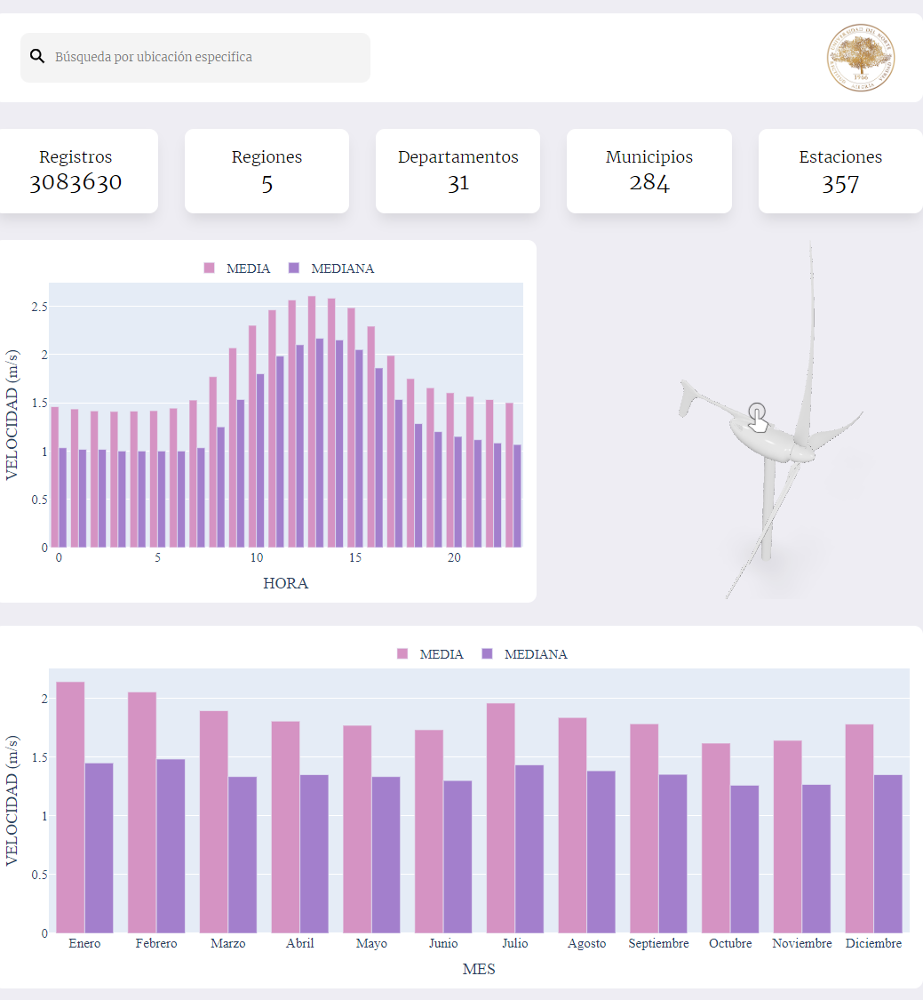

# Viento en Colombia: tablero y predicción horaria

Proyecto de grado de Ingeniería de Sistemas, Universidad del Norte (2023). Autores: Dylan Cantillo Arrieta y Breynner Hurtado Acuña. Tutor: Elías D. Niño-Ruiz.



## Problema

Para diseñar y operar una granja eólica hay que saber cuánto sopla el viento, dónde y a qué hora. Los optimizadores clásicos como Newton convergen rápido desde un buen punto de partida, pero fallan desde uno malo.

## Datos

Velocidad y dirección del viento del IDEAM, publicadas en Datos Abiertos Colombia. Tras la limpieza quedan 3.083.630 registros horarios de 357 estaciones, en 284 municipios y 31 departamentos.

- Los datos crudos se cargan en BigQuery.
- dbt (`dbt_project/`) promedia por hora y estación, normaliza los nombres de departamento y asigna una de cinco regiones.
- Once consultas dejan listas las vistas del tablero: por hora, mes, región y departamento.

## Método

- Optimizador propio: direcciones aleatorias con matrices definidas positivas, restricción al cono y un algoritmo genético que elige los pasos.
- Comparación con Newton en las funciones Rosenbrock y Dixon-Price, con 1.000 dimensiones.
- Predicción: modelo autorregresivo lineal por hora, ajustado con ambos optimizadores.
- Tablero: Django con GraphQL sobre BigQuery y gráficos de Plotly.

## Resultado

| Prueba | Enfoque nuevo | Newton |
|---|---|---|
| Rosenbrock, inicio aleatorio (error) | 23,5 | 139,4 |
| Dixon-Price, inicio aleatorio (error) | 12,96 | no converge |
| Predicción de 2023, R² | 0,709 | 0,833 |
| Predicción de 2023, MAE | 0,512 | 0,336 |

El enfoque nuevo resiste donde Newton falla, desde puntos de partida malos. Con los datos reales de viento, Newton sigue prediciendo mejor.

Informe completo: [PDF](Nuevo%20enfoque%20de%20optimizaci%C3%B3n%20metaheur%C3%ADstica_%20aplicaci%C3%B3n%20en%20granjas%20e%C3%B3licas.pdf).

## Cómo correrlo

Requiere Python 3.12 y una cuenta de servicio de Google Cloud con lectura en BigQuery. La clave no viene en el repositorio.

```sh
python -m venv venv && source venv/bin/activate
pip install -r requirements-django.txt
export GOOGLE_APPLICATION_CREDENTIALS=/ruta/a/tu-clave.json
cd wind_speed && python manage.py runserver
```

Para rehacer las tablas: `pip install -r requirements-dbt.txt`, luego `cd dbt_project && dbt run`. Los cuadernos (`method_.ipynb`, `data_model_.ipynb`) usan `requirements-jupyter.txt`.
